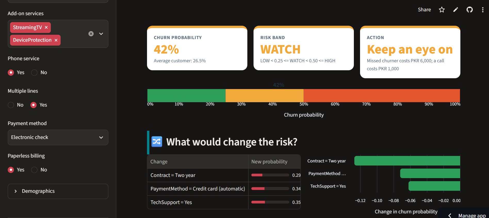
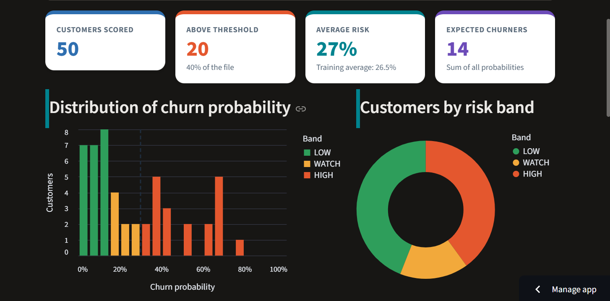

# Applied-AI-Project1-churn
### Week 2: Building ML Models

In Week 2, different machine learning models were developed and evaluated for customer churn prediction. A baseline model was first created by predicting that every customer would stay. This baseline achieved an accuracy of 73.5%. However, because approximately 26.5% of the customers are churners, the baseline completely failed to identify churners, resulting in a recall of 0%. This shows that accuracy alone is not sufficient for evaluating a churn prediction model.

Logistic Regression and Random Forest were the best-performing models, with both achieving a test AUC of approximately 0.842. At the default probability threshold of 0.5, Logistic Regression achieved 80.7% accuracy, 65.8% precision, and 56.7% recall. Random Forest achieved 80.7% accuracy, 67.3% precision, and 52.9% recall. These results show that both models were able to identify a significant portion of customers who were likely to churn.

The Random Forest permutation-importance analysis identified the main factors associated with churn prediction. The three most important features were Tenure, TotalCharges, and Contract_Two year. Other important features included InternetService_Fiber optic and Contract_One year. These features provide useful information about which customer characteristics contribute most to the model's predictions.

The probability threshold was also analyzed because the cost of missing a potential churner is higher than the cost of making an unnecessary retention offer. The empirical business-cost analysis selected a threshold of 0.15, while the theoretical threshold was approximately 0.14. This calculation was based on an assumed cost of PKR 6,000 for a missed churner, or false negative, and PKR 1,000 for an unnecessary retention offer, or false positive. Therefore, a lower threshold can be used to identify more potential churners.

The threshold analysis demonstrated an important trade-off between recall and precision. For example, at a threshold of 0.2, churn recall increased to 85.6%, compared with 56.7% at the default threshold of 0.5. However, precision decreased from 65.8% to 46.7%. This means that lowering the threshold allows the model to identify more potential churners, but it also results in more customers being incorrectly classified as likely to churn.

Class imbalance was another important consideration. The balanced Logistic Regression model increased recall from 56.7% to 78.1%, while precision decreased from 65.8% to 50.5%. This demonstrates the trade-off between identifying a larger number of churners and generating more false-positive predictions.

Feature engineering was also performed by creating four new features: n_services, is_new, charge_per_mo, and price_jump. However, these engineered features did not improve the Random Forest model's performance. The AUC changed only slightly from 0.8422 before feature engineering to 0.8420 after feature engineering. Therefore, the additional features did not provide a meaningful improvement in predictive performance.

A Decision Tree model was also examined to understand the effect of tree depth and overfitting. Increasing the tree depth mproved training accuracy, but after a certain point, the test accuracy decreased. For example, an unrestricted Decision Tree achieved 99.8% training accuracy but only 74.2% test accuracy, which indicates overfitting. In comparison, a depth-5 Decision Tree achieved 80.1% training accuracy and 79.4% test accuracy, showing a smaller gap between training and test performance.

The main lesson from Week 2 is that accuracy alone is not enough when evaluating a customer churn prediction model. Precision, recall, F1-score, AUC, class imbalance, probability threshold selection, feature importance, overfitting, and business costs must also be considered. The model should therefore be evaluated not only according to its statistical performance but also according to the practical business objective of identifying customers who are likely to churn.


## Week 3: Model Optimization and Unsupervised Learning

### Setup
- Dataset: Telco Customer Churn, $N = 7043$ rows, $d = 30$ features after one-hot encoding
- Split: 80/20 stratified, `random_state=42` ($n_{train} = 5634$, $n_{test} = 1409$), churn rate $\approx 0.265$ in both
- Baseline (always predict "Stay"):

$$\text{Acc}_{base} = \frac{1035}{1409} = 0.735$$

---

### Results

**1. Split-to-split accuracy range across 20 seeds:** [min] to [max]

$$\bar{a} = \frac{1}{20}\sum_{i=1}^{20} a_i, \qquad s = \sqrt{\frac{1}{19}\sum_{i=1}^{20}\left(a_i - \bar{a}\right)^2}$$

(single-seed reference, seed 42: LR $= 0.807$, RF $= 0.807$)

**2. 5-fold CV AUC:** LR [X ± s], RF [X ± s], XGBoost [X ± s]

$$\overline{\text{AUC}}_{CV} = \frac{1}{K}\sum_{k=1}^{K}\text{AUC}_k,\quad K = 5, \qquad s_{CV} = \sqrt{\frac{1}{K-1}\sum_{k=1}^{K}\left(\text{AUC}_k - \overline{\text{AUC}}_{CV}\right)^2}$$

(single test split, seed 42: LR $= 0.842$, RF $= 0.842$)

**3. Tuning:** best RF params [..]; grid vs random search time [..]

$$\text{fits}_{grid} = \left(\prod_{j} |V_j|\right) \times K, \qquad \text{fits}_{random} = n_{iter} \times K$$

(current RF: `n_estimators=300`, `max_features='sqrt'`, `min_samples_leaf=5`)

**4. Test AUC of final model (used once):** [X]

**5. Customer segments (k = [k]):** [name 1, churn %], [name 2, churn %], ...

$$J = \sum_{i=1}^{N}\left\lVert \mathbf{x}_i - \boldsymbol{\mu}_{c(i)} \right\rVert^2, \qquad \boldsymbol{\mu}_c = \frac{1}{|C_c|}\sum_{i \in C_c}\mathbf{x}_i$$

$$s(i) = \frac{b(i) - a(i)}{\max\{a(i),\, b(i)\}}, \qquad \text{churn}_c = \frac{\sum_{i \in C_c} y_i}{|C_c|} \times 100\%$$

where $a(i)$ is the mean distance to points in the same cluster and $b(i)$ the mean distance to the nearest other cluster.

**6. PCA:** [n] of 30 components explain 90% of the variance

$$\Sigma = \frac{1}{N-1}Z^{\top}Z, \qquad \Sigma\,\mathbf{v}_j = \lambda_j \mathbf{v}_j, \qquad \text{EVR}_j = \frac{\lambda_j}{\sum_{k=1}^{30}\lambda_k}$$


**7. Biggest lesson:** [one sentence]

---

### Calculations from my notebook

#### Model comparison (test set, $n = 1409$)

| Model | Accuracy | Precision | Recall | F1 | AUC |
|---|---|---|---|---|---|
| Baseline | 0.735 | 0.000 | 0.000 | 0.000 | 0.500 |
| Logistic Regression | 0.807 | 0.658 | 0.567 | 0.609 | 0.842 |
| LR balanced | 0.739 | 0.505 | 0.781 | 0.613 | 0.841 |
| Decision Tree (depth 5) | 0.796 | 0.632 | 0.551 | 0.589 | 0.829 |
| Random Forest | 0.807 | 0.673 | 0.529 | 0.593 | 0.842 |

#### Logistic regression

$$z = b + \sum_{j=1}^{30} w_j x_j, \qquad P(\text{churn}\mid \mathbf{x}) = \sigma(z) = \frac{1}{1 + e^{-z}}$$

$$\ln\frac{p}{1-p} = z, \qquad \text{OR}_j = e^{w_j}$$

Check on test row 0 ($z = -3.070$):

$$\sigma(-3.070) = \frac{1}{1 + e^{3.070}} = \frac{1}{1 + 21.54} = 0.0444$$

This matches sklearn's `predict_proba` (0.0444).

Odds ratios (per +1 standard deviation of the scaled feature):

$$\text{OR}_{tenure} = e^{-1.220} = 0.295 \;\Rightarrow\; (1 - 0.295) = 70.5\%\ \text{lower churn odds}$$

$$\text{OR}_{fiber} = e^{0.779} = 2.179, \qquad \text{OR}_{2\text{-year}} = e^{-0.589} = 0.555$$

#### Confusion matrix: TN = 925, FP = 110, FN = 162, TP = 212

$$\text{Accuracy} = \frac{TP + TN}{n} = \frac{212 + 925}{1409} = 0.807$$

$$\text{Precision} = \frac{TP}{TP + FP} = \frac{212}{322} = 0.658$$

$$\text{Recall} = \frac{TP}{TP + FN} = \frac{212}{374} = 0.567$$

$$F_1 = \frac{2PR}{P + R} = \frac{2(0.658)(0.567)}{0.658 + 0.567} = 0.609$$

#### ROC / AUC

$$\text{TPR} = \frac{TP}{TP + FN}, \qquad \text{FPR} = \frac{FP}{FP + TN}, \qquad \text{AUC} = \int_0^1 \text{TPR}\; d(\text{FPR}) = 0.842$$

#### Business cost and threshold

$$\text{Cost}(t) = FN(t)\cdot C_{FN} + FP(t)\cdot C_{FP}, \qquad C_{FN} = 6000,\; C_{FP} = 1000\ \text{PKR}$$

Flag a customer when the expected cost of ignoring them exceeds the cost of the offer:

$$p \cdot C_{FN} > (1 - p)\cdot C_{FP} \;\Longrightarrow\; p > t^{*} = \frac{C_{FP}}{C_{FP} + C_{FN}} = \frac{1000}{7000} = 0.143$$

The empirical best threshold was $0.15$, close to the theoretical $t^{*}$.

| Threshold | FN | FP | Total cost (PKR) |
|---|---|---|---|
| Never flag anyone | 374 | 0 | $374 \times 6000 = 2{,}244{,}000$ |
| 0.5 | 162 | 110 | $972{,}000 + 110{,}000 = 1{,}082{,}000$ |
| 0.4 | 124 | 191 | $744{,}000 + 191{,}000 = 935{,}000$ |
| 0.3 | 92 | 262 | $552{,}000 + 262{,}000 = 814{,}000$ |
| 0.2 | 54 | 365 | $324{,}000 + 365{,}000 = 689{,}000$ |


#### Decision tree: overfitting

Split criterion (Gini impurity) and information gain:

$$G = 1 - \sum_{k}p_k^{2}, \qquad \Delta G = G_{parent} - \frac{n_L}{n}G_L - \frac{n_R}{n}G_R$$

$$\text{Gap} = \text{Acc}_{train} - \text{Acc}_{test}$$

- Depth 6 (best test accuracy): $\text{Gap} = 0.807 - 0.797 = 0.010$
- Unlimited depth: $\text{Gap} = 0.998 - 0.742 = 0.256$ (overfitting)

#### Random forest

$$\hat{p}_{RF}(\mathbf{x}) = \frac{1}{B}\sum_{b=1}^{B}\hat{p}_b(\mathbf{x}), \qquad B = 300$$

$$\text{PI}_j = \text{AUC}_{base} - \overline{\text{AUC}}_{\text{permuted } j}$$

- OOB accuracy $= 0.803$, test accuracy $= 0.807$, test AUC $= 0.842$
- Top permutation importance (AUC drop): tenure $0.0404$, TotalCharges $0.0206$, two-year contract $0.0164$

#### Feature engineering

$$\Delta\text{AUC} = 0.8420 - 0.8422 = -0.0002 \;\Rightarrow\; \text{no improvement}$$

#### Class weighting

`class_weight='balanced'` uses

$$w_c = \frac{n}{2\, n_c}$$

$$\Delta R = 0.781 - 0.567 = +0.214, \qquad \Delta P = 0.505 - 0.658 = -0.153, \qquad \Delta F_1 = 0.613 - 0.609 = +0.004$$
**7.

Biggest lesson:** A single test score can mislead: my 80.7% accuracy was only 7.2 points above a baseline that always predicts "Stay" (73.5%), so I now judge models by cross-validated AUC and by business cost, not one accuracy number.


# 📡 Churn Risk Advisor

**Project 1: ML-Powered Customer Analytics** | Introduction to Applied AI | Department of Electronics

> A web app that scores telecom customers for churn risk, shows what could lower the risk, explains the score, and scores a whole customer file. It is built on a tuned XGBoost model trained on the IBM Telco dataset.

| | |
|---|---|
| 🔗 **Live app** | **https://applied-ai-project1-churn-vu7jsmzahgvklaeejflutz.streamlit.app/** |
| 💻 **Code** |https://github.com/nk296639-oss/Applied-AI-Project1-churn/blob/main/week-3-model-optimization-lab4.ipynb |
| 📓 **Notebooks (Weeks 1 to 3)** | *https://github.com/nk296639-oss/Applied-AI-Project1-churn* |
| 🏷️ **Version** | v1.0 |

---

## Contents

1. [Model card](#model-card-churn-risk-advisor-v10)
2. [Screenshots](#screenshots)
3. [Key results](#key-results-from-the-notebook)
4. [How the numbers work (equations and hand calculations)](#how-the-numbers-work)
5. [The bug we found and fixed](#the-bug-we-found-and-fixed-training-serving-skew)
6. [What-if analysis](#what-if-analysis)
7. [Run it locally](#run-it-locally)
8. [Repository structure and pinned versions](#repository-structure-and-pinned-versions)
9. [Write it: lab answers](#write-it-lab-answers)
10. [Check your understanding](#check-your-understanding)

---

## Model card: Churn Risk Advisor v1.0

**Intended use:** rank existing telecom customers by churn risk so a retention team can prioritize calls. Decision support, not automation.

**Not for:** credit, pricing, or any decision that denies a service.

**Data:** IBM Telco Customer Churn, 7,043 customers, 26.5% churn.

**Model:** XGBoost (tuned with 30-iteration random search), chosen by 5-fold CV. Features: 30 encoded columns.

**Performance:** CV AUC 0.8502 ± 0.0117; test AUC 0.8483 (test set used once).

**Threshold:** 0.30, from a cost analysis (FN = PKR 6,000, FP = PKR 1,000).

**Limitations:** one US dataset from one period; no Pakistan data; associations, not causes; performance may drift as plans change.

**Fairness check (Week 15):** compare recall across gender and seniors.

**Owner and version:** *[your name]*, v1.0, 2026-11-09.

### Model card at a glance

| Section | Value |
|---|---|
| Model | XGBClassifier, tuned |
| Training rows / test rows | 5,634 / 1,409 (80/20 stratified split, `random_state=42`) |
| Features | 30 one-hot encoded columns from 19 raw inputs |
| CV AUC (5-fold) | **0.8502 ± 0.0117** |
| Test AUC (used once) | **0.8483** |
| Test recall / precision at 0.5 | 0.521 / 0.659 |
| Decision threshold | **0.30** |
| Risk bands | LOW below 0.15, WATCH 0.15 to 0.30, HIGH at 0.30 and above |
| scikit-learn version | **1.6.1** (pinned) |
| Python | 3.11 |
| Files shipped | `churn_model.joblib`, `model_meta.json`, `sample_customers.csv`, `app.py`, `requirements.txt`, `README.md` |

**Honest caveat:** logistic regression (0.8464), random forest (0.8464) and XGBoost (0.8502) are tied within noise (see [Key results](#key-results-from-the-notebook)). XGBoost was kept because it had the highest CV mean.

---

## Screenshots

> 📸 **Add your two screenshots here.** Save them in a `screenshots/` folder in the repo (commit the folder), then they will appear below.
> Take them from your live URL with the default inputs (new, high-spend, month-to-month customer).

### 1. One customer scoring

<!-- Replace the file name below with your screenshot -->


<br>

*Screenshot 1: single-customer score, risk band, what-if table and "Why this score?" chart.*

&nbsp;

### 2. Batch scoring result

<!-- Replace the file name below with your screenshot -->


<br>

*Screenshot 2: `sample_customers.csv` uploaded, 50 customers scored, histogram and download button visible.*

&nbsp;


---

## Key results from the notebook

### Model comparison (5-fold stratified CV on the training set)

| Model | ROC AUC (mean ± std) | Recall | F1 |
|---|---|---|---|
| Logistic Regression (default C) | 0.846 ± 0.013 | 0.545 ± 0.042 | 0.594 ± 0.030 |
| Random Forest (default settings) | 0.844 ± 0.011 | 0.496 ± 0.019 | 0.573 ± 0.020 |

### After tuning (CV AUC)

| Model | Tuning method | Best CV AUC | Std |
|---|---|---|---|
| Logistic Regression | validation curve, best `C = 10` | 0.8464 | 0.0129 |
| Random Forest | grid search (24 combinations, 120 fits) | 0.8468 | n/a |
| Random Forest | random search (24 draws, 120 fits) | 0.8464 | 0.0114 |
| **XGBoost** | **random search (30 draws, 150 fits)** | **0.8502** | **0.0117** |

**Best XGBoost parameters:** `max_depth = 2`, `learning_rate = 0.034`, `n_estimators = 476`, `subsample = 0.6`, `colsample_bytree = 0.561`, `min_child_weight = 1`, `reg_lambda = 1.974`.

### Is XGBoost really better? A hand check

$$\text{gap} = 0.8502 - 0.8464 = 0.0038, \qquad SE_{\text{mean}} \approx \frac{0.0117}{\sqrt{5}} = 0.0052$$

The gap is **smaller than one standard error**, so the three models are statistically tied. In the presentation we say this openly: *"LR and XGBoost tied within noise; XGBoost was nominally best on CV."*

### Same model, different split: how noisy is one number?

Twenty different 75/25 splits of the same training data gave validation accuracy from **0.780 to 0.828** (std 0.0104). Theory predicts

$$SE = \sqrt{\frac{\hat p(1-\hat p)}{n}} = \sqrt{\frac{0.80 \times 0.20}{1409}} = 0.0107, \qquad 95\%\ \text{CI} = \pm 1.96 \times 0.0107 = \pm 0.021$$

which matches the observed spread. A 1 to 2 point difference on one split is noise.

### Customer segments (K-means, k = 4, churn not used to form clusters)

| Segment | Customers | Tenure (months) | Monthly ($) | Services | Churn rate | Lift vs 26.5% |
|---|---|---|---|---|---|---|
| **Mid-tenure high spenders** ⚠️ | 2,157 | 18.4 | 80.4 | 3.3 | **43%** | **1.62×** |
| New low-spend customers | 1,918 | 9.0 | 37.7 | 1.2 | 32% | 1.21× |
| Loyal premium bundlers | 1,938 | 59.8 | 92.1 | 5.1 | 14% | 0.53× |
| Loyal basic customers | 1,030 | 53.6 | 31.0 | 1.5 | 5% | 0.19× |

**Check that the table is consistent:**

$$\text{sizes: } 2157 + 1918 + 1938 + 1030 = 7043 \checkmark$$

$$\text{weighted churn} = \frac{2157(0.43) + 1918(0.32) + 1938(0.14) + 1030(0.05)}{7043} = \frac{1864}{7043} = 26.5\% \checkmark$$

**Insight and action:** the riskiest segment holds about $2157 \times 0.43 \approx 928$ of the 1,869 churners, which is **about 50% of all churners in 31% of customers**. *Suggested action:* offer these customers a one-year or two-year contract before their usual churn point.

### PCA

15 of 30 components are needed for 90% of the variance, so PCA compresses this dataset only a little. PC1 is a "has internet or not" axis (six "No internet service" columns each load 0.302).

---

## How the numbers work

### 1. Class balance

$$\text{churn rate} = \frac{1869}{7043} = 26.5\%, \qquad \text{scale\_pos\_weight} = \frac{N_{neg}}{N_{pos}} = \frac{3311}{1196} = 2.77$$

### 2. Encoding: why there are 30 columns

A categorical feature with $k$ categories becomes $k-1$ binary columns:

| Feature group | Features | Columns each | Total |
|---|---|---|---|
| Numeric (SeniorCitizen, tenure, MonthlyCharges, TotalCharges) | 4 | 1 | 4 |
| Two-category (gender, Partner, Dependents, PhoneService, PaperlessBilling) | 5 | 1 | 5 |
| MultipleLines, InternetService | 2 | 2 | 4 |
| Six add-on services | 6 | 2 | 12 |
| Contract | 1 | 2 | 2 |
| PaymentMethod | 1 | 3 | 3 |
| **Total** | | | **30** |

### 3. Metrics

$$\text{Recall} = \frac{TP}{TP+FN}, \qquad \text{Precision} = \frac{TP}{TP+FP}, \qquad F_1 = \frac{2PR}{P+R}$$

$$\text{AUC} = P\big(\text{score(random churner)} > \text{score(random loyal customer)}\big)$$

*Tiny AUC example:* churners score 0.9, 0.6, 0.4 and loyal customers score 0.5, 0.3, 0.2. Of the 9 pairs, the churner wins $3+3+2 = 8$, so AUC $= 8/9 = 0.889$.

### 4. Test-set confusion matrix at threshold 0.5

Rebuilt by hand from recall = 0.521 and precision = 0.659 on 1,409 test customers (about 374 churners):

$$TP = 0.521 \times 374 = 195, \quad FN = 374 - 195 = 179$$

$$\text{predicted positives} = \frac{195}{0.659} = 296, \quad FP = 296 - 195 = 101, \quad TN = 1409 - 195 - 179 - 101 = 934$$

| | Predicted churn | Predicted stay |
|---|---|---|
| **Actually churned** | TP = 195 | FN = 179 |
| **Actually stayed** | FP = 101 | TN = 934 |

$$F_1 = \frac{2(0.659)(0.521)}{0.659 + 0.521} = 0.582$$

At 0.5 the model **misses 179 of 374 churners (48%)**.

### 5. Why a threshold of 0.30 and not 0.5

Cost of each strategy on the 1,409 test customers (FN = PKR 6,000, FP = PKR 1,000):

| Strategy | Calculation | Cost (PKR) |
|---|---|---|
| Contact nobody | $374 \times 6000$ | 2,244,000 |
| Model at threshold 0.5 | $179 \times 6000 + 101 \times 1000$ | 1,175,000 |
| Contact everybody | $1035 \times 1000$ | 1,035,000 |

A threshold of 0.5 is **not cost-optimal** here. Contact a customer when the expected saving beats the cost of the call. With retention success rate $s$:

$$p \cdot s \cdot C_{FN} > C_{FP} \quad\Longrightarrow\quad t = \frac{C_{FP}}{s \cdot C_{FN}}$$

| Assumption | Threshold $t$ |
|---|---|
| Pure classification cost, $\frac{C_{FP}}{C_{FP}+C_{FN}}$ | $\frac{1000}{7000} = 0.143$ |
| Every call saves the customer ($s = 1$) | $\frac{1000}{6000} = 0.167$ |
| About 55% of calls succeed ($s = 0.55$) | $\frac{1000}{0.55 \times 6000} = 0.303 \approx \mathbf{0.30}$ ✅ |

So **0.30 is consistent with the cost numbers if about 55% of retention calls succeed.** *This success rate is an assumption, not a measured value.*

**Risk bands in the app:** LOW $< t/2 = 0.15$; WATCH from 0.15 to 0.30; HIGH $\ge 0.30$.

### 6. How XGBoost builds its prediction

$$\hat y^{(t)}_i = \hat y^{(t-1)}_i + \eta \, f_t(x_i), \qquad P(\text{churn}) = \sigma(\hat y) = \frac{1}{1+e^{-\hat y}}$$

For one leaf (gradient $g_i = p_i - y_i$, hessian $h_i = p_i(1-p_i)$):

$$w^{*} = -\frac{G}{H + \lambda}$$

*Worked example:* three customers at $p = 0.5$ with $y = 1, 1, 0$ give $G = -0.5$, $H = 0.75$. With $\lambda = 1$: $w^* = 0.5 / 1.75 = 0.286$, and each tree adds only $\eta w^* = 0.03 \times 0.286 = 0.0086$ log-odds, which is why 247 trees were needed.

The early-stopping run used patience 100: best round 247, so training ran $247 + 100 = 347$ rounds and kept 247 trees. Validation AUC on that run: 0.8541.

### 7. The "Why this score?" chart

The app shows the 8 largest feature contributions to the log-odds:

$$\text{log-odds} = \text{bias} + \sum_{j=1}^{30} \text{contribution}_j, \qquad P(\text{churn}) = \sigma(\text{log-odds})$$

Orange bars push toward churn and green bars push away. For a logistic regression the contribution would be exactly $w_j z_j$.

---

## The bug we found and fixed: training-serving skew

Week 3 built features with `pd.get_dummies(drop_first=True)`. With **one customer**, only one `Contract` category is present, so it is treated as the "first" category and dropped. Both Contract columns become 0, which the model reads as **Month-to-month**. No error is raised.

| Version | Contract columns | P(churn) | Odds | Log-odds |
|---|---|---|---|---|
| ✅ Correct (`prepare_input`) | `[0, 1]` (Two year) | **0.012** | 0.0121 | −4.41 |
| ❌ Wrong (Week 3 encoder) | `[0, 0]` (read as Month-to-month) | **0.136** | 0.157 | −1.85 |

$$\frac{0.136}{0.012} = 11.3\times \text{ in probability}, \qquad e^{-1.85 - (-4.41)} = e^{2.56} = 13\times \text{ in odds}$$

**The fix:** encode **without** `drop_first`, then `reindex` to the 30 training columns:

```python
def prepare_input(raw, columns):
    X = pd.get_dummies(raw[RAW_COLS])            # NO drop_first when serving
    return X.reindex(columns=columns, fill_value=0).astype(float)
```

### The parity test

Both paths score all 7,043 customers and must agree:

```python
p_train = model.predict_proba(X[cols])[:, 1]                  # how the model was evaluated
p_serve = model.predict_proba(prepare_input(raw, cols))[:, 1] # how the app calls it
assert np.allclose(p_train, p_serve), 'Training-serving skew!'
```

**Result:** largest difference **0.0**, passed on **7,043 customers** ✅

**Why every row and not five?** If a rare category affects 50 customers ($q = 50/7043 = 0.0071$), a 5-row check misses it with probability

$$(1 - 0.0071)^5 = 0.965$$

so it would pass 96.5% of the time while 50 customers get wrong answers.

---

## What-if analysis

Notebook example on the **riskiest customer** (baseline P(churn) = 0.935):

| Change | New P(churn) | Difference | Relative | Odds |
|---|---|---|---|---|
| Baseline | 0.935 | n/a | n/a | 14.4 |
| Contract = One year | 0.862 | −0.073 | −7.8% | 6.25 |
| **Contract = Two year** | **0.765** | **−0.170** | **−18.2%** | 3.26 |
| Payment = Credit card (automatic) | 0.913 | −0.022 | −2.4% | 10.5 |

$$\Delta = p_{alt} - p_{base} = 0.765 - 0.935 = -0.170, \qquad \text{odds ratio} = \frac{3.26}{14.4} = 0.226$$

Even after the best change the customer stays above the 0.30 threshold, so they remain **HIGH risk**.

> ⚠️ **These are associations, not causes.** The model learned that two-year customers churn less. It does not know whether *offering* a two-year contract would make this customer stay.

---

## Run it locally

```bash
git clone https://github.com/YOUR-USERNAME/churn-risk-advisor.git
cd churn-risk-advisor
python -m venv .venv
.venv\Scripts\activate          # Windows  (Mac/Linux: source .venv/bin/activate)
pip install -r requirements.txt
streamlit run app.py
```

Use **Python 3.11**. The virtual environment installs the pinned scikit-learn for this project only, so your laptop behaves like the deployment server.

### Test it like a user would

| Test | Expected behavior |
|---|---|
| Open the app with default inputs | New, high-spend, month-to-month customer: HIGH band, contact now |
| Set Internet service to No | Add-on selector disappears; probability changes |
| Set tenure 60 and a two-year contract | LOW band |
| Move the threshold slider | Risk band changes; probability does not |
| Open "Why this score?" | Bars for the eight biggest contributions |
| Batch tab: upload `sample_customers.csv` | Scores 50 customers; download works |
| Batch tab: upload a CSV with one column deleted | Clear error naming the missing column, no crash |

---

## Repository structure and pinned versions

```
churn-risk-advisor/
├── app.py                  # Streamlit app
├── churn_model.joblib      # fitted XGBoost model
├── model_meta.json         # columns, versions, threshold, metrics
├── requirements.txt        # pinned versions
├── sample_customers.csv    # 50 customers for the batch demo
├── README.md               # this file (with the model card)
└── screenshots/            # the images used above
```

**`requirements.txt`** (your final model is XGBoost, so `xgboost` is required and pinned):

```
streamlit>=1.32
scikit-learn==1.6.1
xgboost==X.Y.Z        # replace with the version printed by the extra cell in the notebook
pandas
numpy
joblib
```

**Why pin only scikit-learn and xgboost?** The `.joblib` file stores their objects by internal structure, so loading needs the same versions. pandas and numpy only move data in and out.

⚠️ **Security note:** loading a joblib/pickle file runs code stored inside it. Only load model files from a source you trust.

---

## Write it: lab answers

### After Part 1: skew demo and parity

The same two-year customer scored **0.012** with the correct serving encoder and **0.136** with the Week 3 encoder (about 11× in probability, 13× in odds). They differ because `drop_first=True` on one row drops the only Contract category present, so both Contract columns become 0 and the model reads the customer as Month-to-month. **Parity result:** largest difference 0.0 on 7,043 customers, test passed. **What-if:** a two-year contract lowers risk the most (0.935 → 0.765), but that is an association: customers who choose two-year contracts may simply be more loyal, so offering one need not make this customer stay.

### After Part 2: building the app

*Describe one behavior of the app that surprised you, and one input a real user might enter that the app still handles badly.*

- **Surprise:** *[write yours here]*
- **Handled badly:** *[write yours here]*

### After Part 3: deployment

- **Public URL:** *[paste it here]*
- **Did the first deployment succeed?** *[yes / no]*
- **If not, the error line and the fix:** *[quote the error line and explain what fixed it]*

---

## Check your understanding

**1. Why does `get_dummies(drop_first=True)` break predictions when scoring a single customer?**
It drops the first category *present in the data it is given*. With one row, the only category is dropped, so both Contract columns become 0, which the model reads as Month-to-month. Here P(churn) went from 0.012 to 0.136 with no error.

**2. What does the parity test compare, and why must it cover every training row rather than a few?**
It compares the training-path probabilities `predict_proba(X[cols])` with the serving-path probabilities `predict_proba(prepare_input(raw, cols))`. Bugs hide in rare categories: if 50 of 7,043 customers are affected, a 5-row test misses them with probability $(1-0.0071)^5 = 96.5\%$.

**3. Should the model be loaded with `st.cache_resource` or `st.cache_data`? Why?**
`st.cache_resource`. A model is a shared object that should load once per server and be reused as the same object. `st.cache_data` serializes and returns a fresh copy of the result on each call, which is slow and wasteful for a model.

**4. Why does the app derive `TotalCharges` instead of asking the user to type it?**
`TotalCharges` is approximately `tenure × MonthlyCharges`, so a typed value can contradict the other inputs (for example 4 months of tenure and $5,000 total) and create an impossible customer the model has never seen. Deriving it ($4 \times 85 = \$340$) keeps the input consistent.

**5. Why must `requirements.txt` pin the exact scikit-learn version used in training?**
The joblib file stores scikit-learn objects by their internal structure, so a different version may warn, fail to load, or silently behave differently. We pin `scikit-learn==1.6.1`, and also `xgboost`, because the final model is XGBoost.

**6. The what-if shows a two-year contract lowers risk from 0.79 to 0.27. Would offering one make the customer stay? How could a company find out?**
Not necessarily. The model only learned an association; customers on two-year contracts may be loyal for other reasons (confounding and selection bias). A company can find out with a **randomized A/B test**: offer the contract to a random half of a high-risk group, offer nothing to the other half, and compare retention after a few months. Uplift modelling on the results can then find the customers who are actually persuadable.

---

## Limitations and future work

- Trained on **one US telecom dataset from one period**. There is **no Pakistan data**, so the model is not validated for a Pakistani telecom company.
- Predictions are **associations, not causes**.
- Performance may **drift** as plans, prices and competitors change. After launch we would log predictions, compare input distributions with the training data each month, recompute AUC and recall when real outcomes arrive, retrain on a schedule, and rerun the parity test every time.
- **Fairness check (Week 15):** compare recall across gender and senior citizens.

---

<sub>Churn Risk Advisor v1.0 | Decision support only | Owner: *[your name]* | 2026-11-09</sub>
